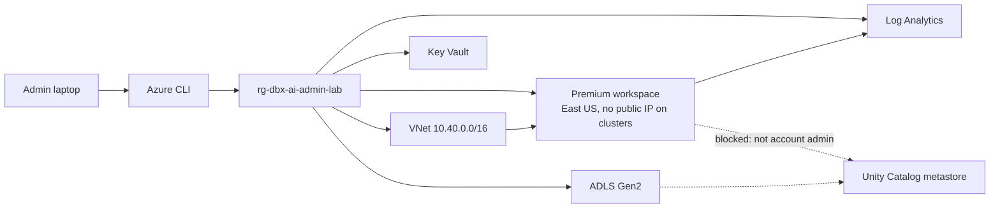

# Databricks AI Platform Admin portfolio

[](https://github.com/Manzoor25/databricks-ai-platform-admin-portfolio/actions/workflows/ci.yml)

Personal lab. Public FDIC data and synthetic rows only. Not an FDIC system, not FedRAMP authorized, not running on GPU.

This is the workspace and the written operating model for a Databricks AI platform administrator supporting a US financial regulator. It is not a claim that every control is live. The status table is the contract.

## Architecture



Solid lines are deployed. Dotted lines are designed and not connected. ADR-0005 explains the dotted line.

## What this demonstrates

| Skill | Evidence |
| --- | --- |
| Workspace administration | Token lifetime 7 days, export off, verbose audit. `evidence/workspace-conf.json` |
| Infrastructure as code | `infra/`. Applied. Two subscription policies encoded, not bypassed |
| Cost guardrails | $150 budget. Default policies now cap auto-termination at 20 minutes. CPU pool min idle is 0 |
| GPU governance without quota | Policy behind `enable_gpu = false`. CPU run in `evidence/cpu-train.json`. No GPU run |
| Honesty about account scope | ADR-0005. Metastore assign returned 403 |

The full map is `docs/COVERAGE_MATRIX.md`.

## Status

| Item | State |
| --- | --- |
| Resource group, VNet, Premium workspace, Key Vault, ADLS, Log Analytics, budget, diagnostic setting | Deployed and in Terraform state |
| Workspace conf (token, export, audit) | Verified via API |
| Public FDIC failures download | 4,117 rows. Sample of 5 committed under `evidence/fdic-sample/` |
| Unit tests | 11 passed locally on 2026-10-27 |
| CPU training entry point | Ran. Output in `evidence/cpu-train.json` |
| Unity Catalog metastore, catalogs, masks, pipelines | Written in `sql/governance.sql`. Not executed. Account admin required |
| AI Search index, serving endpoint, Unity Gateway, Genie space | Config and SQL written. Not created. Same blocker |
| Default cluster policies | Tightened. Personal Compute no longer allowlists `Standard_NC4as_T4_v3`. Evidence: `evidence/policy-tightening.json` |
| Workspace groups and CPU pool | Five SCIM groups. `cpu-lab-pool` created with `min_idle_instances=0`. No node warmed |
| GPU workload | Not run. `enable_gpu=true` plan changes JSON only. Do not say a GPU ran |
| GitHub Actions | Tests and `terraform validate` passed on `a1dcbb0`. Plan is pull-request only and has not run. No apply from CI. OIDC app has no client secret |

## Cost

What is billing now:

- Premium workspace (the control plane; small, but not zero)
- Log Analytics (ingestion is low until the workspace is used)
- Storage account (almost empty)
- Key Vault (almost idle)
- The VNet and budget do not bill

No cluster, model serving endpoint, or vector index was created. A default "Serverless Starter Warehouse" (Small, PRO, auto-stop 10 minutes, id `f4eeb8600375fe7b`) was present and **STOPPED** when checked on 2026-10-27. A stopped warehouse does not bill DBU. Do not start it unless you need it. A rough daily figure for an idle Premium workspace plus these PaaS resources is a few dollars, not tens. Check the budget in the portal rather than trusting a stale number. Budget name: `budget-dbx-ai-admin-lab`, $150/month, alerts at 50, 80, and 100 percent to the owner.

Tear it all down:

```powershell
powershell -ExecutionPolicy Bypass -File scripts/teardown.ps1
```

That destroys the resource group contents via Terraform and keeps this repo. If state is gone:

```powershell
az group delete --name rg-dbx-ai-admin-lab --yes --no-wait
```

## Setup

Tools used: Azure CLI 2.91.0, Terraform 1.16.6, Databricks CLI 1.22.1, Python 3.12.

```powershell
az login
cd infra
terraform init
terraform apply -var-file=terraform.tfvars
```

`enable_gpu` and `enable_private_link` default to false. Leave them there.

## Docs

- `docs/LEARNING_LOG.md` — what happened, including the failures
- `docs/adr/` — region, identity, network, GPU, the account-admin blocker
- `docs/runbooks/` — onboard, token incident, cost spike, cluster start, UC denial, GPU
- `docs/onboarding/` — day 1 guides, FAQ, and a 60-minute AI governance outline
- `docs/interview-prep/` — pitch, STAR, whiteboard, 50 questions
- `docs/certification/study-guide.md` — mapped to the public accreditation page
- `docs/RESUME_BULLETS.md` — only bullets the repo can defend

## Data

FDIC BankFind Suite public API, checked live on 2026-10-27: `https://api.fdic.gov/banks/failures` and `/institutions`. Synthetic complaints from Faker, every row tagged `synthetic-faker`. No non-public FDIC or bank data.

## License

Personal educational lab. FDIC data remains FDIC's. Do not represent this repo as an agency project.
